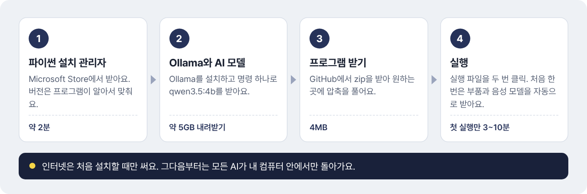
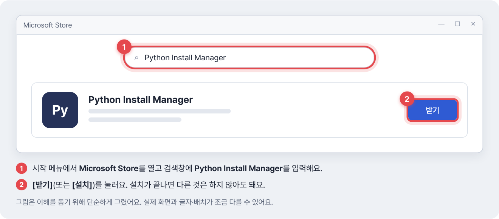
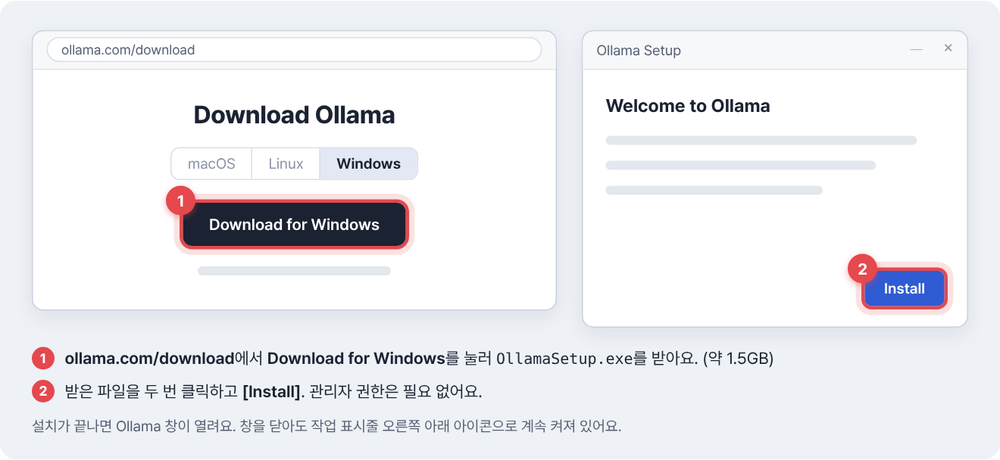
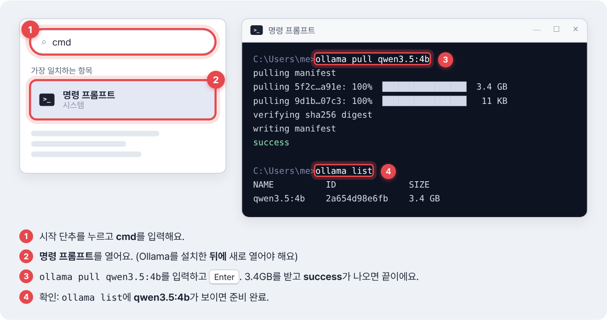
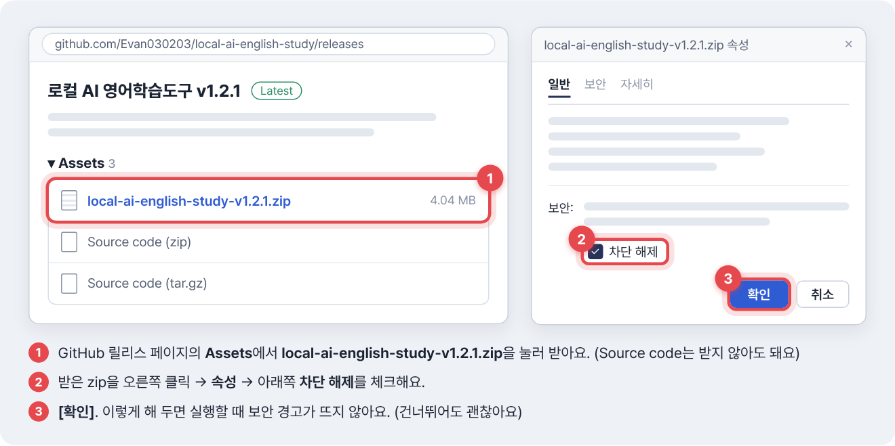
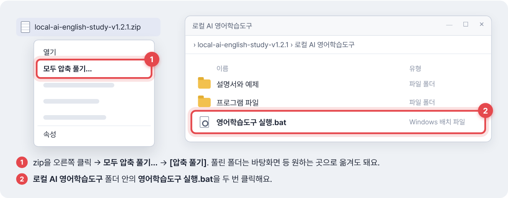
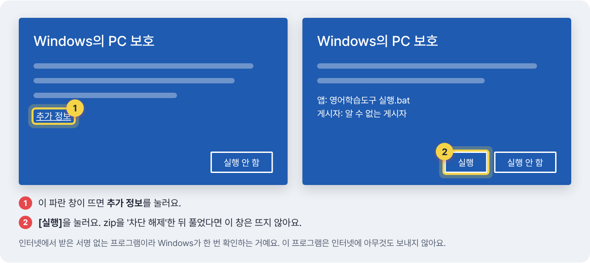
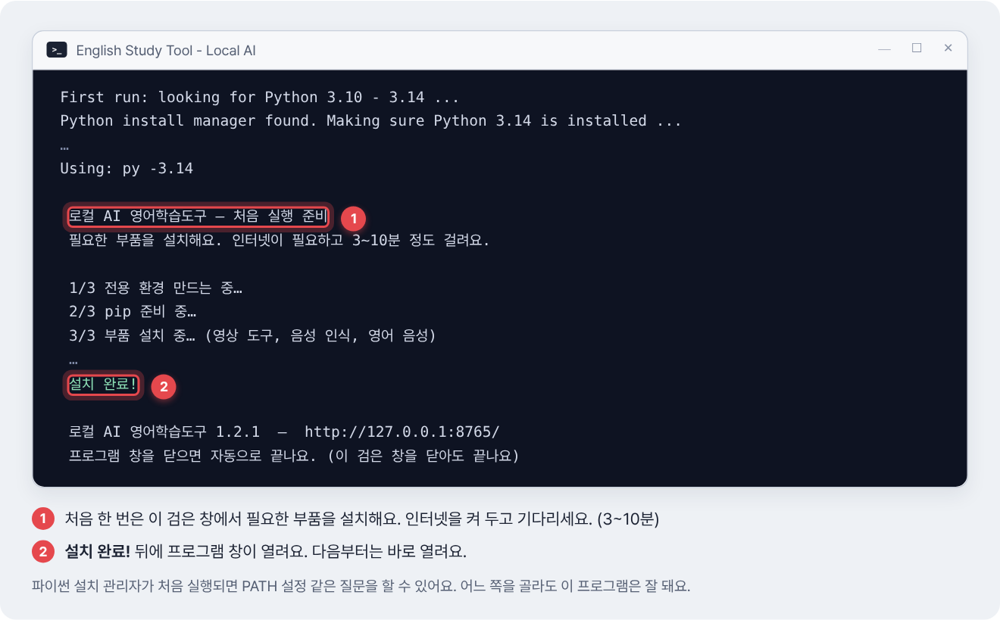
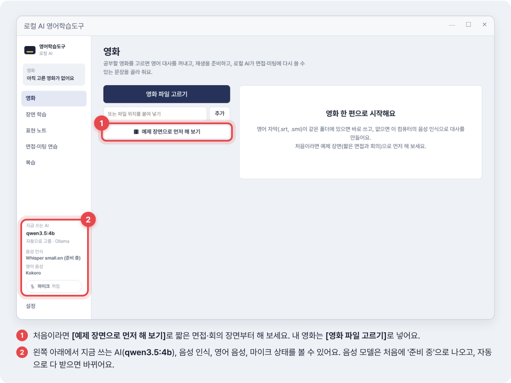

# 설치 안내 (그림으로 보기)

처음 한 번만 하면 돼요. 인터넷 속도에 따라 다르지만 보통 30분 안쪽이에요.
그림은 이해를 돕기 위해 단순하게 그렸어요. 실제 화면과 글자·배치가 조금 다를 수 있어요.



---

## 1. 파이썬 설치 관리자



- 다른 방법: [python.org/downloads](https://www.python.org/downloads/)에서 **Python install manager**(`.msix` 파일)를 받아 두 번 클릭 → **Install**.
  명령 프롬프트에 익숙하다면 `winget install 9NQ7512CXL7T` 한 줄로도 돼요.
- 이미 파이썬 3.10~3.14가 설치돼 있으면 이 단계는 건너뛰어도 돼요.

> **파이썬 버전은 프로그램이 알아서 골라요.**
> 지금(2026년 11월) 최신인 파이썬 3.15에서는 음성 인식과 영어 음성에 쓰는 부품(onnxruntime)을 아직 쓸 수 없어요.
> 그래서 실행 파일이 3.14 → 3.10 순서로 찾고, 설치 관리자만 있으면 3.14를 직접 설치해요.

## 2. Ollama 설치



## 3. AI 모델 받기



- 입력할 명령은 이것 하나예요.
  ```
  ollama pull qwen3.5:4b
  ```
- 컴퓨터가 많이 느리면 더 작은 `qwen3.5:2b`도 쓸 수 있어요. 대신 피드백과 예문의 질은 떨어져요.
- 잘 켜져 있는지 보려면 브라우저 주소창에 `http://127.0.0.1:11434`를 넣어 보세요. **Ollama is running**이 나오면 돼요.

## 4. 프로그램 받기





- 받는 곳: [Releases](https://github.com/Evan030203/local-ai-english-study/releases/latest)

## 5. 실행







다음부터는 `영어학습도구 실행.bat`을 두 번 클릭하면 바로 열려요. 인터넷이 없어도 돼요.

---

## 잘 안 될 때

| 이렇게 나오면 | 이렇게 해 보세요 |
|---|---|
| `Python 3.10 - 3.14 is needed` | 1단계의 파이썬 설치 관리자를 설치하고 다시 실행해요. |
| `음성 부품(onnxruntime)을 아직 찾을 수 없어요` | 명령 프롬프트에서 `py install 3.14`를 실행한 뒤 다시 실행해요. |
| `'ollama'은(는) 내부 또는 외부 명령 … 이 아닙니다` | Ollama를 설치한 뒤 명령 프롬프트를 **새로** 열어요. |
| 프로그램에 `Ollama에 연결할 수 없어요` | 시작 메뉴에서 Ollama를 켜고 프로그램의 [다시 확인]을 눌러요. |
| 처음 설치가 중간에 실패해요 | 인터넷을 확인하고 다시 실행해요. 계속 안 되면 `프로그램 파일\.venv` 폴더를 지우고 다시 실행해요. |
| 프로그램 창이 안 열려요 | 검은 창에 나온 주소 `http://127.0.0.1:8765`를 Edge 주소창에 넣어요. |

더 자세한 사용법은 압축을 푼 폴더의 `설명서와 예제\사용 설명서.txt`에 있어요.
