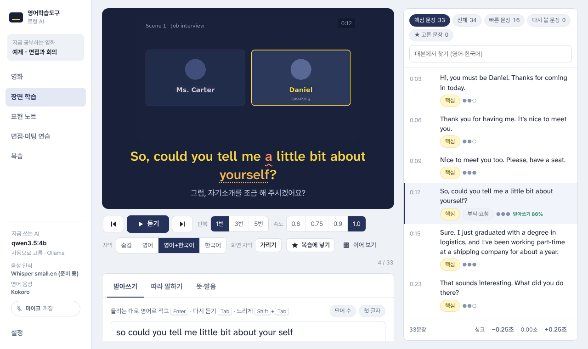
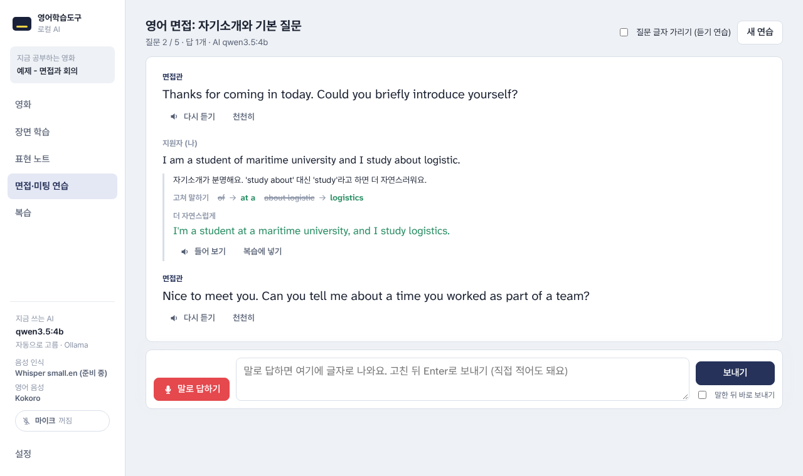

# 로컬 AI 영어학습도구

내가 가진 영화 한 편으로 영어 듣기와 말하기를 연습하는 Windows 프로그램이에요.
대사 분석, 피드백, 음성 인식, 영어 음성까지 모든 AI가 **내 컴퓨터 안에서만** 돌아가요.
목표는 간단한 영어 면접과 회의를 자연스럽게 해내는 것이에요.

*A Windows app for practicing English listening and speaking with your own movies, using only local AI
(Ollama, faster-whisper, Kokoro). Nothing leaves your computer. The interface is in Korean.*



## 할 수 있는 것

- **영화 준비** — 영화와 같은 이름의 영어·한국어 자막(.srt .smi .vtt .ass)을 자동으로 찾고, 영화 안에 든 글자 자막도 꺼내 써요.
  자막이 없으면 음성 인식(Whisper)으로 대사를 만들어요. 로컬 AI가 면접·회의에 다시 쓸 문장을 골라 줘요.
- **장면 학습** — 문장을 누르면 그 장면이 재생돼요. 자막(숨김·영어·영어+한국어·한국어), 반복, 속도를 바꿀 수 있어요.
- **화면 자막 가리기** — 한국어 자막이 영상에 박혀 있는 영화도 자막 위치를 스스로 찾아 가려요.
- **받아쓰기** — 놓친 단어와 그 부분이 잘 안 들리는 이유(gonna 같은 줄여 말하기, water→워러, 이어 말하기)를 알려 줘요.
- **따라 말하기** — 원어민 소리를 듣고 바로 녹음하면 점수, 빠르기, 흐릿하게 들린 단어를 보여 줘요.
- **뜻·발음, 표현 노트** — AI가 면접·회의에서 쓰는 예문과 함께 설명해 주고, 고른 표현을 모아 둬요.
- **면접·미팅 연습** — AI 면접관·회의 상대와 말로 대화해요. 한국어 피드백, 더 자연스러운 답, 바뀐 부분만 보여 주는 '고쳐 말하기'를 받아요.
- **복습** — 어려웠던 문장과 표현이 날짜에 맞춰 다시 나와요.
- **마이크와 개인 정보** — 마이크는 녹음할 때만 켜지고 끝나면 바로 꺼져요. 지금 켜져 있는지, 소리가 들어오는지 늘 보여요.
- **영화 지우기** — 공부하지 않을 영화를 목록과 기록에서 지워요. 원하면 원본 영화 파일을 Windows 휴지통으로 보내요.
- **지금 쓰는 AI 표시** — 어떤 언어 모델, 음성 인식, 영어 음성을 쓰는지 왼쪽 아래에 늘 보여요.



## 필요한 것

| | |
|---|---|
| 운영체제 | Windows 10 또는 11 (64비트) |
| 파이썬 | 3.10~3.14. [파이썬 설치 관리자](https://www.python.org/downloads/)만 있으면 3.14를 알아서 준비해요 |
| 로컬 AI | [Ollama](https://ollama.com/)와 언어 모델 1개 (추천: `qwen3.5:4b`) |
| 창 | Microsoft Edge (Windows에 기본으로 들어 있어요) |
| 메모리 | 8GB 이상, 16GB 권장 |
| 저장 공간 | 프로그램과 음성 모델에 약 1.5GB (Ollama 모델은 따로) |

내려받는 zip(약 4MB)에는 AI 모델이 들어 있지 않아요.
음성 인식(Whisper)과 영어 음성(Kokoro) 모델은 첫 실행 때 프로그램이 알아서 받고,
대화·분석을 맡는 언어 모델만 Ollama로 따로 받으면 돼요.

## 설치와 실행

**[그림으로 보는 설치 안내](INSTALL.md)** — 처음이라면 이 페이지를 따라 하세요.

1. **파이썬 설치 관리자** — Microsoft Store에서 `Python Install Manager`를 받아요. 파이썬 버전은 프로그램이 알아서 맞춰요.
2. **Ollama 설치와 모델 받기** — [ollama.com](https://ollama.com/download)에서 설치한 뒤, 명령 프롬프트에서:
   ```
   ollama pull qwen3.5:4b
   ```
3. **프로그램 받기** — [Releases](https://github.com/Evan030203/local-ai-english-study/releases/latest)에서 `local-ai-english-study-v(버전).zip`을 받아 원하는 곳(예: 바탕화면)에 압축을 풀어요.
4. **실행** — `로컬 AI 영어학습도구` 폴더 안의 **`영어학습도구 실행.bat`** 을 두 번 클릭해요.
   - 처음 한 번은 필요한 부품과 음성 인식(약 480MB)·영어 음성(약 120MB) 모델을 자동으로 받아요. (3~10분, 인터넷 필요)
   - "Windows의 PC 보호" 창이 뜨면 [추가 정보] → [실행]을 눌러요.
5. 처음이라면 **[예제 장면으로 먼저 해 보기]** 를 눌러 보세요. 짧은 영어 면접과 팀 회의 장면이에요.

자세한 사용법은 압축을 푼 폴더의 `설명서와 예제\사용 설명서.txt`에 있어요.

## 개인 정보

- 프로그램은 내 컴퓨터 안(`127.0.0.1`)에서만 열리고, 영상·자막·목소리를 인터넷으로 보내지 않아요.
- 인터넷은 처음 설치할 때만 써요. (파이썬 부품, Hugging Face의 Whisper 모델, GitHub의 Kokoro 음성 모델)
- 따라 말하기 녹음은 '내 녹음 듣기'를 위해 `학습 기록` 폴더에만 남고, 설정에서 한 번에 지울 수 있어요.
  면접·미팅 연습의 답과 마이크 확인 녹음은 글자로 바꾼 뒤 바로 지워요.

## 폴더 구조

```
로컬 AI 영어학습도구/
├─ 영어학습도구 실행.bat     ← 이것만 두 번 클릭
├─ 설명서와 예제/            사용 설명서, 예제 장면
├─ 프로그램 파일/            프로그램 코드, 화면, 글꼴
│                            (처음 실행하면 .venv, 모델, 로그가 여기 생겨요)
└─ 학습 기록/                처음 실행하면 생겨요: 영화별 대사·AI 분석·점수·녹음, 설정, 복습 카드
```

원본 영화 파일은 옮기거나 바꾸지 않아요.

## 새 버전으로 바꾸기

프로그램 창을 닫은 뒤, 새 zip의 `로컬 AI 영어학습도구` 폴더 안 내용을 쓰던 폴더에 덮어쓰세요.
`학습 기록`과 이미 설치한 부품·모델은 그대로 남아요.

## 문제가 생기면

- **"Python 3.10 - 3.14 is needed"** — [파이썬 설치 관리자](INSTALL.md#1-파이썬-설치-관리자)를 설치하고 다시 실행해요.
- **"음성 부품(onnxruntime)을 아직 찾을 수 없어요"** — 명령 프롬프트에서 `py install 3.14`를 실행하고 다시 실행해요.
- **"Ollama에 연결할 수 없어요"** — Ollama를 켠 뒤 [다시 확인]을 눌러요.
- **처음 설치가 중간에 실패했어요** — 인터넷을 확인하고 다시 실행해요. 그래도 안 되면 `프로그램 파일\.venv` 폴더를 지우고 다시 실행해요.
- **창이 안 열려요** — 검은 창에 나온 주소(`http://127.0.0.1:8765`)를 Edge 주소창에 넣어요.
- **영상 화면이 안 나와요 (HEVC 등)** — 영화 화면에서 "재생용 영상 만들기"를 눌러요.
- 기록 파일: `프로그램 파일\로그\englearn.log`

## 영화와 자막

이 프로그램에는 영화가 들어 있지 않아요. 내가 합법적으로 가진 영상과 자막으로 공부하세요.
들어 있는 예제 장면은 이 프로그램을 위해 새로 쓴 대사를 컴퓨터 음성으로 만든 것이에요.

## 라이선스

[MIT License](LICENSE). 함께 들어 있는 글꼴과, 설치할 때 받는 부품·모델의 라이선스는
[THIRD_PARTY_NOTICES.md](THIRD_PARTY_NOTICES.md)에 정리했어요.
